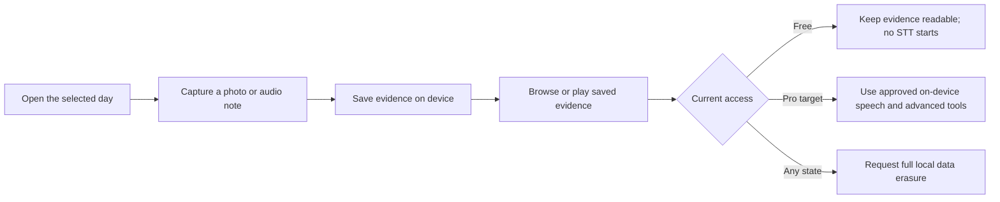
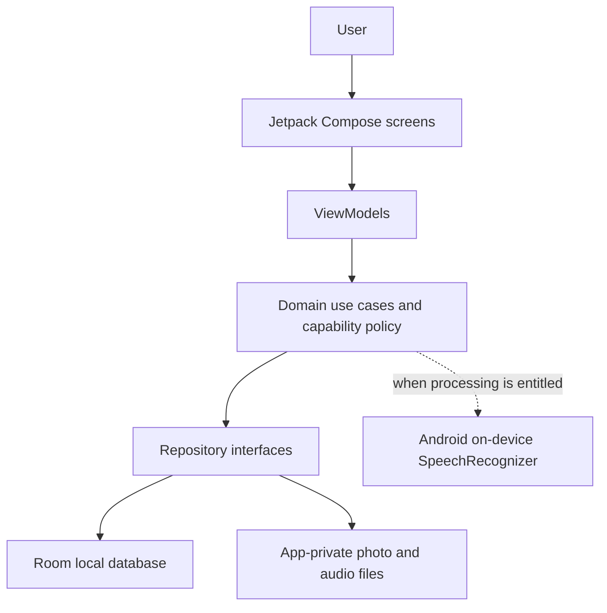

# Acorda — Product & UX Case Study

> **Portfolio website:** open [`index.html`](index.html) for the responsive case-study site featuring Acorda and Drop & Route. Local preview and GitHub Pages steps are in [`WEBSITE_PREVIEW.md`](WEBSITE_PREVIEW.md) and [`GITHUB_PAGES.md`](GITHUB_PAGES.md).

**A local-first Android product for daily planning, personal evidence, and guided breathing.**

> Acorda is a commercial product in active beta development. This repository presents the product and the Product Owner's work. The Android source code remains in a separate private repository.

## The product

Many task tools are centered on what someone plans to do. Acorda explores how a simple daily agenda can also help people record what happened, review personal evidence, and return to routines with less friction.

The product combines a day-based agenda, local photo and audio evidence, and Calma breathing experiences. Its design direction prioritizes quick interactions, clear review states, and keeping personal evidence on the device.

**Intended users:** people who want a practical way to organize daily actions and retain their own notes or evidence without making a cloud account the center of the experience.

**Current status:** active beta and pre-release development. Free/Pro capability enforcement is being implemented and validated. Google Play Billing, purchase verification, and a commercial launch are not complete.

## Product Owner's work

The Product Owner leads:

- Product concept, requirements, and feature priorities.
- UX/UI direction and user interaction design.
- Acceptance criteria and usability decisions.
- Development coordination and review using AI-assisted software development tools.
- Testing oversight and product validation.

AI coding tools support repository analysis, implementation, and test adaptation under the Product Owner's direction. The Product Owner defines product intent, reviews proposed behavior and results, and makes acceptance decisions. This case study does not claim that the Product Owner manually authored every line of source code.

## Product experience

- **Agenda:** a day-oriented place to review plans and recorded activity.
- **Voice evidence:** record and revisit a short local audio note, with recovery paths for interrupted or failed capture.
- **Photo-First evidence:** capture a photo as evidence without requiring a task confirmation first.
- **Calma:** guided breathing experiences designed to stay uninterrupted during an active session.
- **Speech:** Android's on-device `SpeechRecognizer` is the approved speech engine for the initial commercial release. Online speech models are not part of that approved release path.

The current product policy keeps photo/audio capture, browsing, and playback in Free. Free audio is saved without starting speech transcription or Pro processing. The approved plan reserves transcription and advanced capabilities for Pro; expired access must preserve existing evidence. Billing is not implemented, so the commercial entitlement flow is not yet available to customers.

## Design principles

1. **Capture should be deliberate.** Recording begins from a user gesture and saved evidence remains reviewable.
2. **Keep evidence local.** Personal photos, audio, and transcripts belong to the user's device in this product direction.
3. **Separate evidence from confirmation.** A recording or photo can be retained without silently creating or confirming an action.
4. **Make access changes predictable.** Entitlement changes must not remove existing evidence. Full local data erasure remains a privacy action for every account state.
5. **Protect calm moments.** An active breathing session is not interrupted by an entitlement change, and it contains no ads or subscription prompt.

Accessibility considerations include understandable action labels, visible save/recovery states, concise confirmation steps, and English/Spanish localization. A formal accessibility audit is not claimed.

## Main user journey

This diagram reflects the approved product behavior under implementation. It does not imply a released purchase or billing flow.

## High-level technical view

The app is built with Kotlin and Jetpack Compose. Room stores structured local state; app-private storage holds media. The diagram omits database schemas, endpoint names, deployment topology, and other private implementation details.

## Development journey

| Milestone | Status |
|---|---|
| Voice capture and interrupted/failed capture recovery | Implemented in the beta baseline; Free/Pro processing boundaries are part of active validation. |
| Photo-First evidence capture | Implemented in the beta baseline. |
| Agenda interaction design | Implemented in the beta baseline and refined through focused product validation. |
| Calma breathing experiences | Present in the beta baseline; the approved Free/Pro access split is being integrated. |
| Android on-device speech recognition | Approved and used as the initial-release engine; no online STT engine is approved for that release. |
| Free/Pro capability enforcement | In progress. Billing and payment verification are planned follow-on work. |

## Quality approach

Validation uses JVM tests for domain rules and Android emulator instrumentation for persistence and interaction behavior. A recent local pass covered the debug JVM suite, 31 focused emulator tests, and a debug APK build. Release compilation and a public commercial launch are not claimed here.

## Gallery

Approved, anonymized screenshots are still needed. The checklist is in [`gallery/README.md`](gallery/README.md). No user evidence or unverified screenshots are included in this repository.

## Source and contact

The Android application is maintained in a private repository. This public case study has no source-code link and does not grant access to the private repository. Acorda's brand, source, and product materials remain the Product Owner's commercial property; no open-source license is granted here.

For portfolio discussion, contact the Product Owner through the contact details on the GitHub profile.
